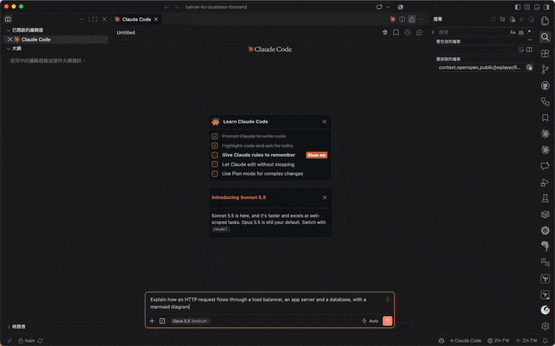

# claude-code-mods

Claude Code mods (function-hook plugins) by Amo Wu.

| Mod | What it does |
| --- | --- |
| [mermaid-view](mods/mermaid-view) | Draws ` ```mermaid ` blocks in Claude's replies as diagrams, right in the conversation |

## Install

At the prompt of a terminal session:

```
/plugin install mermaid-view --marketplace amowu/claude-code-mods
```

From a shell:

```
claude plugin install mermaid-view --marketplace amowu/claude-code-mods
```

Answer `y` to add the marketplace, then pick a scope (user scope loads it in every session). In the desktop app, where `/plugin` does not run: click + next to the prompt box, then Plugins, Add marketplace with `amowu/claude-code-mods`, then Add plugin.

Mods need Claude Code 2.1.288 or later.

## mermaid-view

Claude often explains flows with Mermaid. This mod replaces each closed ` ```mermaid ` block in a reply with the rendered diagram, drawn by [pele](https://github.com/obsidianmd/pele), a small synchronous Mermaid renderer bundled into the mod. No browser, Puppeteer, or network access is involved.



- **Where it draws:** VS Code, the Claude Code desktop app, and mobile. The terminal is left as it is.
- **Copy source:** a "Copy mermaid source" button sits under every diagram.
- **Errors:** a block pele cannot parse stays as code, with pele's error and line number under it.
- **Streaming:** a block still being written stays text until its closing fence arrives.

### Theme

The `theme` option is `auto` by default. Change it under `/config` (`mermaid-view.theme`).

- `auto` in VS Code reads `workbench.colorTheme` from the workspace's `.vscode/settings.json`, then your user `settings.json` (VS Code, Insiders and Cursor). A theme name containing `Light` draws light, anything else (or no setting, VS Code's Dark Modern default) draws dark. With `window.autoDetectColorScheme` on, it follows the OS appearance as VS Code does. The result is re-read every 30 seconds.
- `auto` elsewhere follows the OS appearance (`prefers-color-scheme`).
- `light` or `dark` pins it, for a light theme whose name lacks `Light`.

VS Code draws the diagram as an image, which sees the OS appearance rather than the editor theme, hence the settings lookup.

## License

MIT. `mods/mermaid-view/hooks/vendor/pele.js` bundles pele, also MIT; see [THIRD_PARTY_LICENSES.md](mods/mermaid-view/THIRD_PARTY_LICENSES.md).
